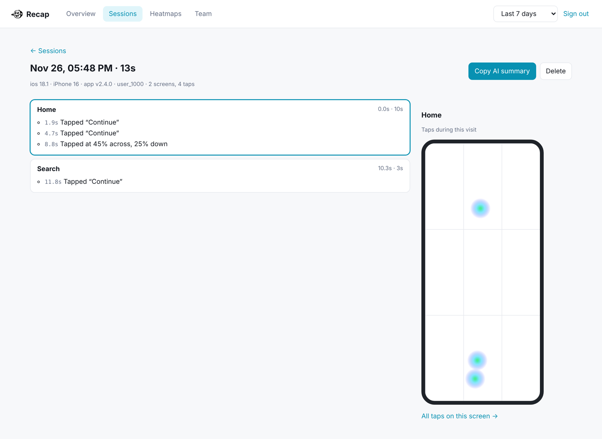

<div align="center">
  
  <h1>Recap</h1>
  <p><strong>Hotjar for AI prototypes.</strong></p>

  <p>
    <a href="https://www.npmjs.com/package/recap-ux"></a>
    <a href="https://bundlephobia.com/package/recap-ux"></a>
    <a href="./LICENSE"></a>
    <a href="https://recap-ux.com"></a>
  </p>

  <br />
  <!-- TODO: record and add demo GIF -->
  
  <br /><br />
</div>

## Try the live demo

Try Recap on a live prototype at **[recap-ux.com](https://recap-ux.com)**. The site itself is instrumented with Recap, so click around, then press `Alt+Shift+Y` to see your own session as a heatmap.

## Why Recap

**One line of HTML.** No accounts, no keys, no dashboards to configure. Add the script tag and you're recording.

**Privacy by design.** Recap sets no cookies and sends nothing by default. Data stays on the test device until you export it. Exports can still contain personal data, so treat them like any research data.

**AI-ready.** Exports a structured session summary that Claude or ChatGPT can actually reason about — not just raw coordinates, but a narrative of hesitation, frustration, backtracking, and friction points. Comes with a ready-to-use prompt template.

**One script tag.** Drops into Claude artefacts, Vercel previews, Framer sites, plain HTML — anywhere a `<script>` tag works.

## What Recap captures

- **Click positions** with auto-generated CSS selectors and semantic element labels
- **Scroll depth** per page, with milestone and continuous tracking
- **Navigation flow** — which pages users visited, in what order, for how long
- **Interaction patterns** — hesitation, rapid clicks, backtracking

Everything is processed in the browser. No cookies. No IP addresses. Data stays on the device where the test runs unless you export it or set up a `data-endpoint` (see [Advanced](#advanced)).

## Mobile apps (beta)

Recap now works in production React Native and Expo apps too. Developers add the SDK once; app owners
review real user sessions in a dashboard they host themselves.

- **SDK** in [`sdk-react-native/`](./sdk-react-native): taps, screens, scroll depth, custom events, offline
  queue, consent and sampling. Never records typed text. Can optionally take one picture of each screen
  from your test phone, so heatmaps show what was tapped, and opt-in screen recordings for session replay
  that pause on private screens and while typing.
- **Your own database**: a few SQL files in [`supabase/`](./supabase) set up tables and locked-down access in
  a free Supabase project.
- **Dashboard** in [`dashboard/`](./dashboard): session replay, journeys, tap heatmaps over real screens, screen exit rates,
  one-click AI session summaries and Mixpanel-style analytics (trends, funnels, retention, breakdowns,
  custom events), deployed to your own Vercel or Netlify.

There is no Recap server, account or fee. Point your coding agent at [AGENTS.md](./AGENTS.md) and ask it to
install Recap: the guide walks it through every step, including Apple and Google privacy disclosures
([docs/mobile-privacy.md](./docs/mobile-privacy.md)). To look around first, run `npm run demo` in
`dashboard/`. How it's tested: [docs/testing.md](./docs/testing.md). Try it on
your own phone in about 20 minutes: [docs/try-it-on-your-phone.md](./docs/try-it-on-your-phone.md).



## Websites and web apps in the same dashboard (beta)

The web script can send sessions to the same Supabase project and dashboard as your mobile apps, so web,
iOS and Android sit side by side in one set of analytics. Leave `supabase` out and Recap keeps working the
original way, with nothing leaving the browser.

```js
import Recap from 'recap-ux';
import { record } from 'rrweb'; // optional: page recordings for replay

Recap.init({
  appId: 'my-site',
  supabase: { url: 'https://your-project.supabase.co', anonKey: 'sb_publishable_…' },
  recordings: { record }, // leave out for analytics and heatmaps only
});
Recap.track('signed_up', { plan: 'pro' }); // custom events for funnels
```

Or with a script tag: `<script src="…/recap.min.js" data-app-id="my-site" data-supabase-url="…" data-supabase-key="…"></script>`
(add `data-recordings="true"` and load rrweb's script first for replays).

Importing `recap-ux` as a module starts nothing until you call `Recap.init()`. The script tag (`recap.min.js`)
starts itself from its `data-*` attributes.

Page recordings use [rrweb](https://github.com/rrweb-io/rrweb): they capture the page's structure and changes rather than
pictures, so replays are sharp and smooth, scrolling and open menus included. Every form field is masked, and anything
marked `class="recap-private"` or `data-ut-no-track` is left out. They need `supabase/migrations/*_recap_dom.sql`.
Try it with the test shop in [`examples/web-test-shop/`](./examples/web-test-shop).

**On a live site**, these settings keep visitors' details out and Recap's own tools hidden:

```js
Recap.init({
  appId: 'my-site',
  supabase: { url, anonKey },
  panel: false,                 // no researcher panel, shortcut or three-finger hold for visitors
  labels: 'attributes',         // tap labels from aria-label, title, alt only, never on-screen text (the default once sending)
  screenName: (path) => path.replace(/\.html$/, ''), // count /plan and /plan.html as one screen
  requireConsent: true,         // record nothing until Recap.optIn()
  recordings: { record, maskText: true }, // replays show the layout with every word replaced by *
});

// From your cookie banner or settings page:
Recap.optIn();   // remembered in this browser
Recap.optOut();  // stops at once, deletes anything not yet sent and the copy kept in this browser; remembered, and other open tabs follow it
```

| Setting | What it does |
| --- | --- |
| `panel: false` | Turns off the researcher panel, its keyboard shortcut and the touch-hold. `shortcut: false` turns off only the shortcut. A later `init()` can change it |
| `labels` | Where tap labels come from: `'text'` also uses the tapped element's visible text, `'attributes'` only `aria-label`, `aria-labelledby`, `title`, `alt` and `placeholder`, `'none'` only your own `data-ut-label`. Default: `'text'` while data stays in the browser, `'attributes'` once sessions go to a dashboard |
| `screenName(path)` | Returns the name to count a page under. Used for page views, taps, scrolls and dashboard screens. Return nothing to keep the path |
| `requireConsent` | Nothing is recorded or sent until `Recap.optIn()`. `Recap.optOut()` works either way, and both choices are kept in `localStorage` (`recap-consent`), so other open tabs of the site follow them at once. `Recap.isRecording()` says where things stand |
| `recordings.maskText` | `true` replaces all text in replays with `*`, or pass a CSS selector for the parts to mask. `.ut-mask` text is always masked |

Set `screenName` in your first `init()` call. With the script tag, add `data-auto-init="false"` and call
`Recap.init({ screenName })` yourself: the tag's other `data-*` settings still apply.

## Quick start

Add one line to any prototype:

```html
<script defer src="https://cdn.jsdelivr.net/npm/recap-ux@1/dist/recap.min.js"></script>
```

That's it. Recap starts recording silently. When you're ready to review, press `Alt+Shift+Y` to open the researcher panel.

## AI analysis export

Click **"Export for AI"** in the researcher panel to get a structured JSON summary optimised for LLM analysis. Paste it into Claude with the included prompt template to get a full UX analysis covering friction points, navigation patterns, accessibility observations, and specific recommendations.

The summary is a human-readable narrative of the session, not raw coordinates — an AI can reason about *"Participant hesitated for 12 seconds, then clicked an unlabelled element three times in rapid succession before backtracking"* in a way it never could with a dump of `pageX`/`pageY` values.

## In-person moderated tests

When you're testing in person and need to add another participant, open the same prototype in a new browser tab. Recap creates a new session per tab, so each participant is captured separately.

On a phone or tablet there's no keyboard for `Alt+Shift+Y` — hold **three fingers** on the screen for about **1.5 seconds** instead. It's a deliberately "hidden" gesture (no on-screen button), so it never shows up as something for the participant to notice or tap.

The researcher panel now includes:

- A `Session` help icon directly beside the label
- A hover/focus tooltip with: "To add another participant, open this prototype in a new tab."
- An `Open in new tab` shortcut inside the tooltip

A ready-to-run moderated validation script lives at [`examples/in-person-usability-validation.md`](./examples/in-person-usability-validation.md).

## Configuration

All options are `data-*` attributes on the script tag:

| Attribute | Default | Description |
|-----------|---------|-------------|
| `data-session-name` | auto | Label for this session, e.g. `"participant-04"` |
| `data-show-panel` | `"false"` | Show researcher panel on load |
| `data-panel` | `"true"` | `"false"` turns off the researcher panel, its shortcut and the touch-hold. Use it on live sites |
| `data-shortcut` | `"alt+shift+y"` | Keyboard shortcut for the researcher panel. Format: modifiers and one key joined by `+`, e.g. `"ctrl+shift+y"`. `"false"` for none |
| `data-labels` | `"text"`, or `"attributes"` with Supabase | Where tap labels come from: `"text"`, `"attributes"` or `"none"` (see [Element labelling](#element-labelling)) |
| `data-require-consent` | `"false"` | Record nothing until the page calls `Recap.optIn()` |
| `data-auto-init` | `"true"` | `"false"` waits for the page to call `Recap.init()`, with the tag's settings underneath |
| `data-recap` | none | Marks this tag as Recap's, if you renamed the file |
| `data-supabase-url` | none | Your Supabase project URL. With `data-supabase-key`, sessions also go to the Recap dashboard (see [Web sessions in the dashboard](#web-sessions-in-the-dashboard)) |
| `data-supabase-key` | none | Your Supabase **public anon or publishable key**. Never the service role key |
| `data-app-id` | page hostname | Name for this site in the dashboard, e.g. `my-shop-web` |
| `data-app-version` | none | Your site's version, shown in the dashboard |
| `data-recordings` | `"false"` | With Supabase set: record pages for replay in the dashboard. Load rrweb's script before Recap's |
| `data-mask-text` | none | With recordings: `"true"` replaces all text in replays with `*`, or a CSS selector for the parts to mask |
| `data-endpoint` | none | URL to POST captured events to in batches (see [Advanced](#advanced)) |
| `data-strip-query-params` | `"true"` | Remove query strings from recorded URLs. Set to `"false"` to keep them |
| `data-touch-trigger` | `"true"` | Hold 3 fingers on screen to open/close the panel on touch devices |
| `data-touch-trigger-fingers` | `3` | Number of simultaneous touch points required |
| `data-touch-trigger-hold-ms` | `1500` | Hold duration (ms) before the panel toggles |

### Keyboard shortcut not working

The shortcut is matched on the physical key, but another app can still claim the key combination before the browser sees it. If `Alt+Shift+Y` does nothing:

- **Browser extensions:** open `chrome://extensions/shortcuts` in Chrome and look for the same combination. Clear it or change it there.
- **Other apps:** check any global hotkey tools, such as dictation, screen recording or launcher apps.
- **Windows:** `Alt+Shift` is the default keyboard-language switch. If your system uses it, pick a different shortcut.

To use a different key, set `data-shortcut` on the script tag, for example `data-shortcut="ctrl+shift+y"`.

## Element labelling

A tap is counted on the element it was aimed at: the closest button, link, form control, element with a
clickable role, or element with `data-ut-label`. A tap on an icon inside a button is a tap on the button.

Recap labels it from, in order: `data-ut-label`, `aria-label`, `aria-labelledby`, `title`, `alt`, the visible text
(first 50 characters) and `placeholder`. The `labels` setting limits that: `'text'` uses them all,
`'attributes'` everything except the visible text, and `'none'` only `data-ut-label`. It defaults to `'text'`
while data stays in the browser and `'attributes'` once sessions go to a dashboard. For ambiguous elements,
add explicit labels:

```html
<button data-ut-label="Submit assessment">Save</button>
<div data-ut-label="Filter panel">...</div>
```

To keep sensitive things out:

```html
<input type="password" data-ut-no-track />
<section class="recap-private">No taps counted, and left out of recordings</section>
<div class="ut-block">Same as recap-private</div>
<span class="ut-mask">Never used in labels, and masked in recordings</span>
```

`data-ut-no-track`, `recap-private` and `ut-block` cover everything inside them; on `<body>` they also stop
scroll depth. Inside `ut-mask`, only `data-ut-label` can label a tap: never `aria-label`, `title`, `alt`,
`aria-labelledby`, `placeholder` or text.

## Advanced

### Sending events to your own server

Set `data-endpoint` on the script tag to a URL you control. Recap then posts captured events to that URL in batches, using `navigator.sendBeacon` with a `fetch` fallback. Nothing is sent unless this option is set, and the endpoint receives the same data the panel shows.

### Web sessions in the dashboard

If you use the Recap dashboard for a mobile app (see [Mobile apps](#mobile-apps-beta)), the web library can send to the same Supabase project. Run the same migrations, then:

```html
<script src="https://unpkg.com/recap-ux/dist/recap.min.js"
  data-supabase-url="https://your-project.supabase.co"
  data-supabase-key="your-public-anon-key"
  data-app-id="my-shop-web"></script>
```

Pages, clicks, scroll depth and tab switches appear in the dashboard with platform `web`. Typed text is never captured. The panel and local storage keep working as before, so nothing changes for people who don't use Supabase. For page replays and custom events, see [Websites and web apps in the same dashboard](#websites-and-web-apps-in-the-same-dashboard-beta).

## Development

```bash
git clone https://github.com/tonyarbor/recap-ux.git
cd recap-ux
npm install
npm run dev          # Watch mode with example page
npm test             # Run unit tests
npm run build        # Build dist/ bundles
```

Project structure and architecture details are in [`ARCHITECTURE.md`](./ARCHITECTURE.md).

## Contributing

Contributions welcome. Please read [`CONTRIBUTING.md`](./CONTRIBUTING.md) before opening a pull request. For significant changes, open an issue first to discuss what you'd like to change.

## Licence

MIT © [Tony Craig](https://www.npmjs.com/~tonyarbor)

---

<div align="center">
  <sub>Built with care for designers who want to ship better prototypes.</sub>
</div>
